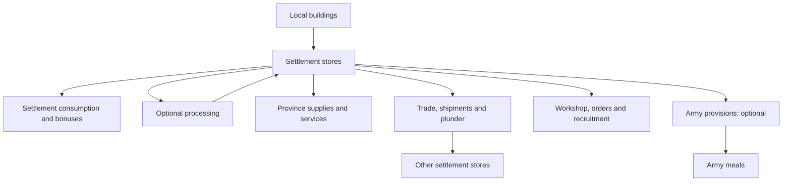

# Derpy Resource Overhaul: mechanics reference

Source-checked **21 October 2026**. The essential-goods and half-full starting-cargo revision is locally deployed and MCP-verified through three owner-turn cycles and exact cold reload. The processed-only Hardtack Exchange supply gap was fixed during that test. See the [native evidence and limits](sessions/LIVE_TEST_20261021_ESSENTIAL_GOODS.md). Game closed and original settings restored; no Workshop publication. The later [service-label fix](sessions/HANDOFF_20261021_SERVICE_BENEFIT_LABELS.md) (main `e75ce0c9`, deployed and native-checked) makes the Settlements view show each service's real benefit (`-5% cost`, `+3% replen.`, `+5 growth`) instead of labelling every service except Civic Records as control.

The later [terrain-route addition](sessions/HANDOFF_20261021_TERRAIN_TRADE_ROUTES.md) draws faction-coloured dashed paths on the 3D campaign map, around impassable terrain and across water, and since 2026-10-22 round land hostile to either party wherever a detour exists; the line size and colours are MCT choices (Campaign settings, below). Cargo indicators track existing saved shipment positions; the Vault Map draws the same roads. Since 2026-10-22 an agreement's road also decides whether it trades ([Trade reach](#trade-reach-2026-10-22)). Main `3AE6E88B`, deployed to `data/` 2026-10-23 ([route logic](sessions/HANDOFF_20261023_ROUTE_LOGIC.md)); nearby routes merge into shared corridors on both maps, carts and dashes round corners, and Small is the default line size ([current handoff](sessions/HANDOFF_20261022_TRADE_ROUTES_CURRENT.md)). Rendering is single-player only; the routes do not model army zones of control or live blockades.

## Contents

1. [Purpose and current scope](#purpose-and-current-scope)
2. [Goods, production and storage](#goods-production-and-storage)
3. [Reserves, targets and forecasts](#reserves-targets-and-forecasts)
4. [Trade, duty and selling](#trade-duty-and-selling)
5. [Shipments and capture](#shipments-and-capture)
6. [Settlement consumption and spending](#settlement-consumption-and-spending)
7. [Workshop and recruitment](#workshop-and-recruitment)
8. [Processing and services](#processing-and-services)
9. [Army provisions](#army-provisions)
10. [Interface, settings and AI](#interface-settings-and-ai)
11. [Implementation status and limits](#implementation-status-and-limits)
12. [Source ownership and evidence](#source-ownership-and-evidence)

## Purpose and current scope

The mod turns trade goods into physical settlement stocks. Buildings produce goods; settlements retain them; trade, shipments and plunder move them; armies, recruitment, services and purchases consume them. Location matters for recurring settlement costs and army resupply, while several deliberate purchases can draw across the realm.

It supplements the native campaign economy. Gold income, native trade agreements, recruitment buildings and normal recruitment costs continue to exist.

The numbered expansion priorities are: **#1 stock policies**, **#2 Exchange appetites**, **#3 processing**, **#4 sustained services**, **#5 army provisions**, and **#6 trade routes/contracts**. Numbers 1, 3, 4, 5 and 6 are implemented in the main local build. Number 2 is implemented in the separately deployed Exchange build; it changes demand while preserving investment fund baskets.

## Goods, production and storage

### Resource catalog

There are **58 stored goods: 41 added goods and 17 native goods**. Each belongs to one spending category. The eight **bold** goods are rare: ordinary category spending excludes them, although exact recipes and rare Workshop purchases can consume them.

| Category | Goods |
|---|---|
| Provisions | Hardtack, Grain, Salted Fish, Salted Meat, Olive Oil, Tea, Kvas, Mead, Rum, Beer, Wine, Spices, Salt, Medicine |
| Building materials | Cloth, Tools, Timber, Marble, Pottery, Glassware, **Starwood** |
| War materials | Leather, Iron, Coal, Brass, Blackpowder, Brimstone, **Gromril**, **Ithilmar**, Quicksilver, Obsidian, Whale Oil |
| Mount supplies | Warhorses, **Griffon and Pegasus Feathers**, Rhinox Hides, **Wyvern Scales**, **Dragon Bone**, **Sea Dragon Hide**, Animals, Tusks, Furs |
| Luxuries | Silk, Jade, Arabyan Carpets, Porcelain, Pearls, Amber, Lustrian Plumes, Incense, **Black Lotus**, Pipeweed, Books, Gems, Gold Idols, Dyes, Trinkets, Silver, Wool |

These categories describe what goods can pay for. They are not separate pooled currencies: a store still holds each individual good.

### Production

The mod attaches production to existing buildings using culture, location and building conditions. Farms, ports, mines, industry and specialist buildings supply different goods. It does not edit the campaign start-position map or guarantee every culture a local producer for every good. Trade and conquest therefore matter.

Existing farm chains produce Grain without homeland/climate gates; existing hunting chains produce Salted Meat without the old Ogre/Mountains of Mourn restriction. Chaos Dwarfs, Greenskins, Warriors of Chaos, Skaven, Cathay and Norsca also receive Salted Meat from ordinary main-settlement chains at **8/12/16/20/24** by chain level. These are local provision levies, not new buildings or goods. Damaged production is halved and ruined production is zero. Production on supported map-specific primary chains follows the same rule.

Ordinary output fills native settlement resource pools. Capacity limits what can be retained. Passive building production continues when optional processing is disabled. Hunting chains also supply Leather, craft chains supply Cloth, and metalworking chains supply Tools. Hardtack has no passive building source: it is made from Grain and Salt through processing, or issued once as starting army cargo. The Exchange counts a completed biscuit batch from the current or previous turn as supply, attributed to its still-current owner; an idle bakery does not create market supply.

The eight rare goods also have dedicated three-level production chains. Availability is restricted by culture and eligible geography/deposits:

| Rare good | Main eligible producers and locations |
|---|---|
| Gromril | Dwarfs; qualifying mountain deposits |
| Ithilmar | High Elves; qualifying Ulthuan deposits and Vaul's Anvil |
| Dragon Bone | Eligible cultures at specified dragon grave sites, including Caledor and the Plain of Bones |
| Sea Dragon Hide | Dark Elves; qualifying cold Naggaroth ports |
| Black Lotus | Dark Elves and Skaven; qualifying Southlands/Khuresh jungles |
| Starwood | Wood Elves; Athel Loren |
| Griffon and Pegasus Feathers | Empire and Bretonnia; qualifying mountain regions |
| Wyvern Scales | Greenskins and Ogres; qualifying Badlands/Mountains of Mourn regions |

The Vault's eligible-location view is the practical source for a particular campaign. A regional name alone does not bypass culture, building or slot requirements. Rare-building levels cost **1,000 / 2,000 / 3,000 gold**, requiring settlement tier **1 / 2 / 3** respectively. These production buildings are separate from paid Workshop settlement upgrades.

Main campaign support includes Immortal Empires and Realm of Chaos; `_iee` and `_oldworld` companion packs supply their map-specific compatibility data.

### Storage and culture eligibility

Capacity is **per good, per settlement**, rather than a shared warehouse total. Main-settlement tiers provide 200-unit capacity steps up to 1,000. Damage does not remove the settlement's capacity. Production cannot create unlimited overflow.

Occupation retains the settlement's remaining stocks for its new owner. Razing or abandoning removes the settlement pools. Ownership and capacity are checked again when goods arrive or actions execute.

Stores gameplay excludes Daemons of Chaos, the four monogod daemon cultures, Tomb Kings, Nagash and Beastmen. **Vampire Counts and Vampire Coast retain stores and trade but do not consume settlement or army meals.** Their old army shortage records and penalties retire through the normal owner-turn cleanup. Production is a separate layer: an excluded owner can still possess a captured building with native production effects; that does not make all stores actions available to it.

## Reserves, targets and forecasts

### Automatic defaults and per-resource overrides (#1)

**Keep** is the reserve below which an outward transfer should stop. **Target** is the amount incoming scripted trade should try to reach. Each resource can use automatic policy or explicit overrides.

Automatic policy normally reserves **five turns** of recurring demand and targets **ten turns**. Demand includes settlement food, enabled province supplies, and exact inputs of enabled processing and services. War materials and luxuries also account for the stock needed to maintain holding bonuses. Named inputs keep their identity: a Books requirement cannot be satisfied merely by importing unrelated luxuries. The calculation avoids counting the same recurring use twice.

Targets account for cargo already on its way and available storage. Rare goods can have Workshop purchase targets rather than being treated as disposable category stock. Automatic policy is recalculated as demand changes; explicit settings let the player choose a different reserve or target.

Eligible armies with Auto-refill enabled add their meal requirements to the current owned, unsieged land region's recurring food forecast, five-turn reserve and ten-turn target. Multiple visiting armies add together. Moving away, pausing Auto, embarking or losing local eligibility removes that region's army demand. Forecasts assume the current armies stay; they do not predict marching orders.

### What Keep protects

| Action | Treatment of reserves |
|---|---|
| Scripted exports, internal shipments and selling | Use removable stock above Keep, including automatic reserves for local armies |
| Army loading | Can consume the army portion of Auto Keep, while retaining essential/named reserves and explicit per-resource Keep |
| Optional processing | Inputs must remain affordable above Keep |
| Sustained services | Preserve five turns of base essential/province-supply demand; ignore explicit Keep and named-input reservations for their own payment |
| Settlement meals, province-supply payments, recruitment, manual orders, events and Workshop purchases | Can spend held stock, including reserves |

Keep is therefore a logistics policy, not a universal spending prohibition. A large manual purchase can still leave a settlement below its preferred reserve.

Forecasts combine known production, recurring use and committed incoming cargo. They are estimates, not promises of future imports, successful processing batches or safety from plunder. Opening previews does not spend goods or advance the economy. History retains **20 turns**.

## Trade, duty and selling

### Three different trade systems

| System | What it does |
|---|---|
| Native CA trade | Continues to calculate normal trade income from agreements and production |
| Scripted stock trade | Moves actual stored goods between treaty partners to meet recipient targets |
| Optional Grand Trade Exchange | Supplies its own market, prices and investments; installed separately |

Scripted stock trade runs on the exporter's turn. For each good and partner it selects the exporter's settlement with the largest removable surplus, then sends up to **5%** of that surplus by default, rounded down. The recipient's target deficit and free space limit the transfer. Goods arrive directly at the partner's home-capital destination; this is not a two-turn internal cart.

For example, 100 removable units permit a five-unit export at the default rate, provided the partner needs five and can store them. The calculation does not export 5% of the entire realm's combined holdings from every settlement.

The Trade tab supports per-resource import and export holds. Export holds also use production-marker effects to suppress the corresponding production available for native export; they do not delete existing stores. Import holds govern scripted partner imports. Internal shipments use their own controls.

### Trade reach (2026-10-22)

An agreement moves stored goods and import duty only while **a road joins the two home capitals that takes no more than the reach** (default **6 turns**, 1–10, at 40 hexes a turn, so 240 hexes) **and keeps off land hostile to either side**. Hostile land is a region owned by a faction at war with either partner, by rebels, or by a faction whose attitude to either partner is **-70 or worse** (the diplomacy screen's "very unfriendly"). The partners' own regions never count. The road is a hex search on the installed map's pathfinding grid (`R.reach` in `terrain_routes.lua`), with hostile land as a wall and the reach as a length limit, so one search answers both "too far" and "cut off by enemy lands"; the reason is the second when a road through hostile land would have been short enough. A map with no generated grid never stops trade.

The answer is worked out once per pair per turn by whichever partner's turn start asks first, which is the same on every machine. The Trade tab lists the partners cut off, with why, in a **Trade cut off** row under Import duty. On the 3D map an agreement that is cut off draws no line, and one that runs draws the road the trade uses. **Native CA trade income is not affected**: the engine pays it from the agreement itself, and the only lever there is the per-good, faction-wide export hold.

Timing measured offline on the Immortal Empires grid (stock Lua 5.1, no engine lookups): an open road 7 ms, a detour round enemy land 29 ms, a capital ringed by enemies 10 ms, the worst case found (a long enemy wall) 101 ms at 6 turns and 348 ms at 10. A pair further apart than the reach in a straight line is rejected before any search. In game (vanilla Immortal Empires, 2026-10-22) a search took 9-341 ms from Uzkulak and 746 ms at worst (Altdorf to Karak Norn, cut off by enemy land); 12 agreements cost 1.3 s at the player's turn start. With "goods move between other factions" on (the default) computer-to-computer agreements are judged too, and 42 of them took about 4 s of one end turn, 7.6 s in a 20-partner test. Since 2026-10-23 the native grid edges are decoded once per hex and reused, which took the same 107 pairs from 7.4 s to 4.0 s warm with identical answers. **The author decided on 2026-10-23 to keep computer-only pairs on the full rule for now.** The recorded alternatives are caching a computer-only pair's answer for a few turns, or skipping the rule between two computer factions.

Reach answers are dropped and worked out again the same turn when war is declared, on a positive or negative diplomatic event, and when a region changes owner (`F.invalidate_reach`, 2026-10-23). Queued route searches and the bundled road network are dropped with them. An attitude change made by script without one of those events waits for the next turn's answer.

### Import duty

At the payer's turn, trade partners can receive a duty based on their current production value: **10% by default**, rounded down and capped by the payer's remaining treasury. The value uses native resource trade values, not the Exchange's market quote.

Duty is a gold transfer between factions. It is based on production rather than the exact quantity of stock delivered that turn, and can apply even when a particular import target is already full. It is additional to native treaty income. A partner out of trade reach pays and receives no duty.

### Selling excess

A sale can remove only stock above Keep **and** above half the realm's combined capacity for that good. It is not a button to liquidate every holding.

Without an available Exchange price, unit prices are **1 gold for provisions, 2 for building materials, 3 for war materials, 4 for mount supplies and 5 for luxuries**. A compatible Exchange can supply its sell price per unit instead. Selling creates gold; it does not create an internal shipment or a new diplomatic contract.

## Shipments and capture

### Internal shipments

Manual **Send here**, standing province supply and recurring named orders move goods between owned settlements. They respect source reserves, import/export holds, destination capacity and incoming commitments. Newly dispatched carts carry at most **100 gross units** and take **clamp(ceil(coordinate distance / 40), 1, 6) owner turns**, saved at dispatch. Each loses **10% of its dispatched amount, rounded up**. A 100-unit dispatch therefore carries 90 units to arrival. Existing carts keep their saved due turn, with the former two-turn rule only as a fallback for missing due data.

The default simultaneous limit is **three shipments for a human faction**, configurable from one to ten, and **one for AI**. Cargo leaves the source immediately. On supported maps, new shipments save a traversable road at dispatch, preferring detours around hostile territory. At each owner turn the cargo, caravan scene and interception trigger advance to the same point along that saved road. The 3D line and Vault Map use that road too. Travel time remains the coordinate-distance estimate above; movement is per turn, without continuous animation. Older shipments, unsupported maps and failed searches retain the former source/destination staging. A saved journey is not rerouted when diplomacy changes. Separately, up to sixteen rigid vehicles provide nearby visual traffic: minecarts on land and [low-poly boats at sea](sessions/HANDOFF_20261023_LOW_POLY_TRADE_BOATS.md). [Supplier culture chooses nine land families and 23 ship styles](sessions/HANDOFF_20261023_FACTION_TRADE_VEHICLES.md), with shared land fallbacks where needed. Each model retains only its final LOD (up to 1,909 triangles and four meshes), shares the total sixteen-vehicle cap, and reuses native textures and the existing movement callback. Empty returns retain their prior supplier vehicle. No FPS delta has been measured. They glide between points and turn back at endpoints; they do not represent the precise location of an interceptable shipment. Every route in view gets one vehicle before any route gets a second, return vehicle. Vehicles depart independently, keep four hexes apart along shared hexes, reverse at the destination and return within the same campaign turn. A one-way route drives no empty leg. Animation never moves stock. [Cargo selection previews the real allocator](sessions/HANDOFF_20261023_TRADE_TRAFFIC_ACCURACY.md), respecting switches, reserves, recipient demand/capacity, incoming cargo, rate/rounding and ordered shared surplus. Empty returns carry no resource icon; zero-flow agreements retain the road without vehicles. No skeletal or wheel animation is played. This display runs only in single player.

Standing supply pulls eligible category goods from owned minor settlements in the same province. It starts replenishing below five payments' worth at the capital, counting incoming cargo, and aims toward ten payments' worth. The normal shipment cap and travel loss still apply.

If the destination is lost, arriving cargo tries the owner's settlement nearest the original destination. Without a surviving recipient settlement it is lost. Capacity still limits delivery.

### Recurring named orders and paid contracts

Click a settlement resource, or open a resource's Trade rules, to choose an owned or treaty-partner source. **Create** accepts the displayed destination, named good, net stock target and gross batch cap. Edit the order under **Spending**: target steps by ten (minimum one), batch is 2–100, and each control's default is 100. Up to 50 orders per buyer; identical source/destination/good orders cannot be duplicated. Pause stops future dispatch; Cancel removes the order.

Each owner turn, an enabled order requests only `target - local stock - committed net cargo`, limited by free capacity, source Keep, holds and cart space. At most one dispatch per order per turn. A named order replaces standing category dispatch to that destination, including while paused until cancelled. Multiple sources share incoming reservations. There are no independently enabled AI purchase contracts; existing AI standing supply and army relief use the new cart bounds.

An internal order costs no gold. A **partner contract** requires a current trade agreement, a buyer-owned destination and trade reach between its own source and destination settlements (status "Too far for trade" or "Cut off by enemy lands"; cargo already on the road still arrives). Creating it locks the ordinary category sale rate at an integer **1/2/3/4/5 gold per delivered provision/building/war/mount/luxury unit**; Exchange prices do not enter this calculation. The buyer owns the cart and escort. Its seller and recipient are saved separately.

Only a dispatched batch reserves gold: native treasury is debited once for its maximum net delivery, with a saved escrow balance. Dispatch verifies both native gold and source-goods debits. The seller receives payment only for cargo actually credited at arrival. Cargo above arrival capacity is lost and its gold refunds the buyer; free general trade counts committed cargo rather than filling that same deficit twice. Existing import duty remains separate and unchanged.

Seizure refunds unpaid escrow and transfers net cargo under the normal capture rule. Cancellation, treaty loss/war, a captured destination or dead party returns remaining net cargo immediately to the seller's original owned settlement or nearest owned fallback and refunds the buyer. Capacity can destroy excess return cargo; a dead seller cannot receive cargo. A dead refund/payment recipient's gold is recorded as lost, never credited to another faction. Settlement and cargo removal are idempotent. Pause does not recall travelling cargo. Cancelling an internal order leaves its already dispatched carts travelling normally.

### Escorts and interception

Threatened shipments can trigger escort battles. Escort strength scales with cargo and campaign progress. Players can receive attack/defence choices; disabling escorts or encountering unsupported battle situations leaves the underlying seizure rules in effect.

Only **one escort battle can start in an owner's turn-start sequence**. Other threatened carts may be seized without a second battle. Escort support is therefore not a guarantee that every cart receives a playable defence.

Seized cargo goes to the captor's nearest settlement, subject to capacity. A captor without a settlement cannot retain it.

### Raiding, sacking and razing

Default plunder rates are **10% for a raid turn**, **50% for a sack** and **50% for a raze**. These take individual goods, including rare goods. A positive rate can take at least one unit from a nonempty holding.

Loot is delivered to the attacker's nearest owned settlement. Excess that cannot fit is lost; there is no automatic realm-wide redistribution. Ordinary occupation instead changes ownership of the remaining local pools. Siege-battle snapshots preserve the pre-destruction stock information needed by sack/raze handling.

## Settlement consumption and spending

### Recurring consumption and holding bonuses

An eligible living settlement consumes **two common provisions per settlement level per owner turn**. Available food can be partially consumed when insufficient; the system does not create food debt or directly damage the settlement.

After consumption, holdings determine these bonuses:

| Condition | Benefit |
|---|---|
| At least five more settlement meals in common provisions | +10 province growth |
| Common war materials total at least 25% of one good's local capacity | +4 melee attack and +4 melee defence for the garrison |
| Common luxuries total at least 25% of one good's local capacity | +3 province control |

These are evaluated from settlement stores. They are separate from the paid province services and the army shortage system.

### Province supplies

Each enabled supply costs **two goods per owned settlement in the province, every owner turn**, paid from the owned province capital. The whole required category payment must be affordable.

| Supply | Goods category | Benefit |
|---|---|---|
| Materials on Hand | Building materials | -25% construction cost |
| Stable Stocked | Mount supplies | -15% cavalry/monster recruitment cost |
| Arms Stocked | War materials | -15% infantry/artillery recruitment cost |

The benefit is applied to owned settlements in the province. Insufficient stock removes the benefit and **switches the supply off**. Standing supply is the optional shipment order that tries to keep the capital stocked; it is not an instant transfer or a guaranteed payment.

### Realm orders

Each order consumes **200 common goods across the realm**, lasts **five turns**, and has a **ten-turn cooldown**:

| Order | Payment | Benefit |
|---|---|---|
| Festival | Luxuries | +4 province control |
| Muster | War materials | +1 recruitment rank |
| Great Works | Building materials | -20% construction cost |

### Scripted opportunities

| Opportunity | Payment and result |
|---|---|
| Feast | 100 local provisions; +5 control and +20 growth for five turns |
| Siege Stores | 60 local provisions; siege-attrition protection for two turns |
| Tribute | 50 realm luxuries; improves relations with an eligible peaceful neighbour |
| Arsenal | 50 realm war materials; +1 rank to units in the largest army |
| Restore | 100 local building materials after an eligible capture; repairs buildings and grants +5 control for five turns |
| Enemy Shipment | Attack the shipment's escort or let it pass |

Offers have their own eligibility and timing checks. Costs are rechecked when accepted. These scripted opportunities are distinct from CA's natural random dilemmas.

## Workshop and recruitment

### Rare purchases and settlement upgrades

The Workshop contains **29 rare-item entries, 20 rare-unit entries and eight rare settlement upgrades**. Culture and target requirements restrict what a faction can buy.

| Purchase type | Base goods price | Restrictions |
|---|---|---|
| Rare item | 40 of its rare good +150 common category goods | Each item once per campaign |
| Rare unit | 30 rare +100 common category goods | Eligible culture; pool or direct-army route; pool maximum two |
| Settlement upgrade | 60 rare +200 common category goods | Eligible owned settlement; owner-bound benefit |
| Research | 300 luxuries | Grants 400 research points; ten-turn cooldown |

Upgrades grant regional/province effects rather than adding another production chain: Gromril Gate improves defence/armour; Ithilmar Spire grants control/income; Dragon Bone Shrine grants recruit rank; Sea Dragon Moorings grants income; Black Lotus Gardens improves hero action success; Starwood Grove grants growth; Eyrie reduces recruitment cost; Wyvern Roost reduces local army upkeep. Their benefits are inactive for a captor who did not purchase them.

Paid pool recruits receive one resource-charge exemption when recruited later, avoiding double payment. Directly granted units do not leave an exemption for the next ordinary recruit.

### Named recipes

There are **19 named recipes**, in addition to the rare purchases above. Exact ingredients matter; unrelated goods in the same category cannot substitute.

| Recipe | Inputs | Result |
|---|---|---|
| Chaos Dwarf conversion | 20 Coal +20 Brimstone +20 Iron | 30 Armaments |
| Skaven conversion | 30 Grain +30 Salted Fish | 4 Food |
| Dwarf conversion | 30 Gold Idols +30 Silver | 30 Oathgold |
| Vampire Coast conversion | 30 Rum +30 Pearls | 50 Infamy, a victory score rather than spending money |
| Rations and Drill | 35 Grain +35 Salt +35 Beer | +1 rank to the target army's units |
| Ammunition Train | 50 Blackpowder +50 Brass | +20% ammunition for five turns |
| Field Forge | 50 Iron +50 Coal | +15 armour for five turns |
| Remounts | 50 Warhorses +50 Animals | +10% replenishment for five turns |
| Medicine Chests | 50 Medicine +50 Wine | 25% attrition resistance for five turns |
| Silk-robed | 50 Silk +50 Dyes +50 Jade | Character trait: +10 diplomacy |
| Steel-shod | 80 Iron +80 Brass | Character trait: +10 armour |
| Well-read | 80 Books +80 Glassware | Character trait: +20% experience |
| Spice-hardened | 60 Spices +60 Incense | Lord trait: +4 leadership, -5% movement |
| Furred and Booted | 60 Furs +60 Wool | Lord trait: 25% attrition resistance |
| Great Granary | 120 each Grain, Salt, Salted Meat, Pottery | Permanent faction +15 growth |
| Hall of Records | 150 each Books, Glassware, Silver | Permanent faction +15% research |
| Grand Bazaar | 120 each Silk, Arabyan Carpets, Dyes, Spices | Permanent faction +15% trade income |
| Arsenal | 150 each Iron, Coal, Brass, Blackpowder | Permanent faction -10% army upkeep |
| Royal Stables | 150 each Warhorses, Furs, Tusks, Timber | Permanent faction -20% cavalry recruitment cost |

Conversions have a one-turn wait and require the destination pooled resource to exist and have room for the full output. Army works have a five-turn cooldown per army and recipe; traits are once per character; permanent faction works are once per campaign. There is no Ogre Meat conversion.

**Rations and Drill grants ranks; it does not fill the army-provisions cargo described below.** The event named Arsenal, the permanent Arsenal work and Arms Stocked are separate purchases with different effects.

### Recruitment draw

Normal recruitment consumes resources in addition to native campaign recruitment costs. The base bill is:

`ceil(native custom-battle gold value / 100 × configured recruitment rate)`

The default rate is one. The reference value is the unit's custom-battle/multiplayer value, not its campaign recruitment price.

| Unit caste | Main resource draw |
|---|---|
| Melee/missile infantry | War materials at 1× base |
| Monstrous infantry | War materials at 1.5× base |
| Ordinary cavalry and chariots | Mount supplies at 1× base |
| Monstrous cavalry, war beasts and monsters | Mount supplies at 1.5× base |
| War machines | Half war materials, half building materials; cumulative rounding preserves the total |

Lords, heroes, unknown castes and zero-value units do not receive an invented bill. Units valued at least **1,200** can also require `ceil(value / 400)` of a culture-specific rare good. These include Gromril for Dwarfs, Ithilmar for High Elves, Starwood for Wood Elves and the matching beast goods for several mount-focused cultures. Dark Elf infantry uses Black Lotus rather than Sea Dragon Hide.

Payment draws held goods across the realm. A Chaos Dwarf shortfall first uses one Armament per two missing goods, rounded up; Skaven use one Food per five. Remaining shortfall costs gold at twice the cheapest matching good's native unit trade value, capped by available treasury. There is no Ogre Meat recruitment charge. This is a capped surcharge, not a debt or automatic cancellation of the recruited unit.

## Processing and services

### Local processing (#3)

Processing adds optional batches on top of passive production. The global setting defaults on; individual player recipes must be enabled in the settlement view.

The current catalog has nine recipes and eight province services.

| Recipe | Eligible producer | One batch |
|---|---|---|
| Brewing | Dwarf taverns, Empire basic industry, Bretonnian extra farm chain | 12 Grain → 8 Beer |
| Preservation | Ogre hunting/farm chain | 8 Animals +4 Salt → 8 Salted Meat |
| Powder | Eligible Dwarf/Chaos Dwarf industry, furnace or assembly buildings | 8 Coal +4 Brimstone → 8 Blackpowder |
| Printing | Empire basic industry | 8 Timber +4 Dyes → 8 Books |
| Carpet weaving | Cathay Yin income chain | 8 Wool +4 Dyes → 8 Arabyan Carpets |
| Campaign biscuits | Eligible Dwarf, human and elf farms; Chaos Dwarf living quarters | 8 Grain +2 Salt → 12 Hardtack |
| Hide curing | Eligible human/elf crafts and Lizardmen, Wood Elf or Ogre farms/hunts | 6 Animals +2 Salt → 8 Leather |
| Plain weaving | Eligible human, High Elf, Dark Elf and Lizardmen craft chains | 8 Wool → 8 Cloth |
| Toolmaking | Eligible Dwarf/Chaos Dwarf, Empire and Cathay industry | 6 Iron +2 Timber → 8 Tools |

Each enabled recipe runs at most once per owner turn. The settlement must still be owned, culture-eligible and have a fully healthy eligible building. All inputs must be available locally above Keep, and the entire output must fit. A blocked batch charges nothing. Ownership changes clear the local orders; eligibility is checked again before execution.

Processing inputs enter automatic stock policy. Its output is conditional and should not be treated as guaranteed production in a forecast.

### Sustained province services (#4)

Services are enabled at an owned province capital, with **one selected service per province**. The global setting defaults on; player selections start off. Each full local basket buys that turn's benefit.

| Service | Culture | Per-turn payment | Benefit |
|---|---|---|---|
| Drinking Halls | Dwarfs | 4 Beer +1 Pipeweed | +2 province control |
| Civic Records | Empire | 2 Books +1 Glassware | +5 province growth |
| Tea Houses | Cathay | 3 Tea +1 Porcelain | +2 province control |
| Village feasts | Bretonnia | 3 Wine +2 Salted Meat | +2 province control |
| Scholars' halls | High Elves | 2 Books +1 Trinkets | +5 province growth |
| Factory mess | Chaos Dwarfs | 3 Salted Meat +2 Beer | +2 province control |
| Builders' yards | All fifteen supported living store cultures | 2 Tools +1 Cloth | -5% own-province construction cost |
| Field hospitals | All fifteen supported living store cultures | 2 Cloth +1 Leather +1 Medicine | +3% replenishment for own armies in the province |

Services preserve five turns of base essential/province-supply demand when deciding whether payment is safe. They do not enforce the player's explicit Keep as an absolute payment floor. A missing basket removes the bonus but **leaves the service enabled**, so it can resume when goods arrive. Disabling the service or losing eligibility removes its effect.

Services, province supplies and stock-holding bonuses can coexist. They have distinct costs and shortage behaviour.

## Army provisions

### Carried food and local loading (#5)

Army provisions are **on by default for new campaigns** and frozen into campaign settings. Existing saved switches stay unchanged; older saved settings missing the army switch retain its former off default. When enabled, each eligible field army has a saved cargo ledger tied to its military force. The display combines food into rations, while the ledger retains the original goods for unloading.

An army's meal is `max(1, ceil(unit count / 4))` provisions per owner turn. Normal automatic loading aims to leave **five meals after eating**, with a **ten-meal capacity**. Loading before the meal therefore aims for six meals. Manual loading after a meal aims for five.

Each newly tracked eligible army receives **five meals once**, exactly half its initial capacity. Empire, Bretonnia, Dwarf, High Elf, Dark Elf, Kislev and Cathay armies receive Hardtack; other eligible cultures receive Salted Meat. The first meal is due on the next owner turn. A new twenty-unit army therefore starts with 25 goods out of 50, without debiting stores or gold. Existing cargo is preserved without a top-up. A saved force-ID registry prevents another grant after reload, duplicate creation events or ledger retirement; changing the lord does not create a new force ID. Undead and excluded forces receive none.

For a 20-unit army, a meal is five goods. Auto-loading before the meal aims for 30 carried goods, then consumption leaves 25; capacity is 50. This depends on the source settlement having enough removable food.

Loading requires the army's current region to be owned by its faction, on land and not besieged. It takes common provisions from that region, retaining settlement/named demand reserves and explicit Keep. The army can spend the automatic reserve allocated for army loading. It cannot pull from the whole realm, an ally, foreign territory or a sea region. Garrison forces, scripted shipment escorts, stores-ineligible cultures, Vampire Counts and Vampire Coast are excluded.

The army view offers automatic loading, manual loading and unloading. Unloading returns original goods only as far as local capacity allows, retains the rest on the army, and pauses automatic loading. Local loading and unloading require an eligible local destination.

Selecting an owned army lord adds a Provisions food-icon button to the native army action bar. Its number shows food needed each turn. The tooltip gives carried/capacity, the gap to the five-meal target, missed meals and local loading availability. Clicking opens that army's existing Vault detail view. Heroes, enemy lords and garrisons do not show it; a saved-off campaign shows a disabled explanation. Food icons also mark armies in Spending and their refill details.

### Limited field purchases

An eligible army **at sea**, or belonging to a faction with **no settlements**, can buy field rations through its existing Load row (shown as **Buy field rations**). The quote shows quantity and total gold. Each ration costs **10 gold**, and purchases can top up to **two meals carried**, at most once per army per turn. Actual gold payment is confirmed before cargo is credited; the purchase-turn stamp survives save/reload. At sea these goods are Salted Fish; on land they are Salted Meat.

Human purchases are manual: Auto-refill never spends gold on field rations. Eligible AI armies with Auto enabled use the same price, stock target and turn limit before eating. A settled faction's army in foreign/vassal land cannot use this fallback on land. Field purchases do not access settlement stock or permit remote unloading. Native Skaven Food and Ogre Meat remain separate currencies.

### Shortage and recovery

| Consecutive incomplete meals | Effect |
|---|---|
| First | Warning |
| Second | -5% movement |
| Third and later | -10% movement and -10% replenishment |

Partial food is consumed, but an incomplete meal still advances the shortage count. One full meal resets the count and removes the shortage penalties. The mechanic does not script direct hit-point damage.

At sea an army retains cargo and eats it; it can buy limited field rations but cannot load or unload settlement stores. A shrinking force retains existing cargo even if it exceeds its newly reduced capacity; army composition changes do not mint food. Changing the general preserves the force's inventory. Destruction/retirement loses cargo, and ownership changes discard the old owner's cargo. Nearby armies do not automatically inherit it.

In an existing save, armies that already have a cargo ledger keep it unchanged; other eligible armies receive the one-time five-meal cargo on the first tick after loading (`F.provision_seed_all`). Previewing does not seed or refill them, and a saved turn guard prevents duplicate meals from repeated callbacks.

## Interface, settings and AI

### Resource Vault

| Tab | Purpose |
|---|---|
| Resources | Realm resource totals, individual-good details, stock policy and forecasts |
| Settlements | Local stores, production, processing and capital service controls |
| Trade | Import/export policy |
| Spending | Supplies, orders, shipments, recruitment/duty records and army provisions |
| Map | Settlement and shipment locations |
| Workshop | Rare purchases, upgrades, research and named recipes |

The Vault is reached through the mod's HUD opener/hub. Detail views and tooltips explain eligibility and blocked actions. The maintained layouts include a 720p testing format; validation evidence distinguishes offline previews from actual in-game checks.

### Campaign settings

| Setting | Default | Available range / meaning |
|---|---|---|
| Raid share | 10% | 0–50% |
| Sack share | 50% | 0–100% |
| Raze share | 50% | 0–100% |
| Scripted trade share | 5% | 0–25% |
| Import duty | 10% | 0–50% |
| Trade reach | 6 turns | 1–10; no "any distance" setting, since a cut-off pair's search covers everything within reach |
| Human shipment cap | 3 | 1–10 |
| Recruitment rate | 1 | 0–5 per 100 reference gold |
| AI stores actions | On | Enables AI participation in stores gameplay |
| Settlement upkeep, orders, scripted opportunities, supplies, recruitment and escorts | On | Separate mechanic switches |
| Processing and sustained services | On | Global permission; individual player orders still need enabling |
| Army provisions | **On** | New campaigns; existing saved switches stay unchanged |
| Disable natural random dilemmas | Off | Suppresses CA's natural random dilemmas, not all scripted/story dilemmas |
| Line size (trade route lines) | Small | Small (0.7x), Normal, Large (1.5x): the dashes and the cargo marker on the campaign map |
| Line colours (trade route lines) | Default | Default (gold, blue, green, red), Bright, Pale, Colour-blind friendly: the four owner colours on the campaign map and the Vault Map |

Settings are frozen into saved campaign state when first initialized, except the two trade route line settings: they move no goods, stay open in a campaign and show at the next redraw. Added keys are filled once for an older save without replacing its existing settings; pre-provisions saved settings retain the former off default for that one key. Frontend changes are not a reliable way to reconfigure a campaign whose settings are already saved. Multiplayer uses defaults to avoid disagreement between client MCT values; new campaigns now include army provisions.

### AI participation

The AI uses the same physical stores and payments. It can maintain province supplies and undertake Workshop purchases. Processing and services use affordability checks for two payments/batches; Workshop purchases similarly require extra stock headroom and are limited rather than buying everything each turn. AI shipments have their own one-cart cap.

Rare-production construction also has a dedicated AI routine, spread over five-turn faction schedules and requiring treasury headroom. Do not assume every independent AI routine is controlled by the stores-action switch. Disabling AI stores actions also does not cancel player-to-AI trade or duty flows when a human participant is involved.

When army provisions are enabled, eligible AI armies also eat and refill locally, or buy capped field rations when at sea or without settlements. AI relief dispatches existing paid shipments from other owned settlements to eligible local army regions, prioritizing consecutive shortages and then region key. Donor Keep, import/export holds, incoming commitments, capacity, cart limits, travel time and transport loss still apply. This runs after meals and before province supplies. There is no free food or immediate shipment-to-army transfer.

Relief cannot feed armies at sea or in foreign territory, and does not command the native AI to return home. Food-poor realms may lack a donor, and an army can move away before its shipment arrives. Long-campaign balance remains unresolved; the author requested the system enabled by default for new campaigns.

### Turn sequencing

The scripted owner-turn economy broadly processes arriving shipments, settlement consumption, army meals/refill, province supplies, processing/services, partner stock trade, duty and later opportunities/AI purchases. Consequently, an import arriving later in that sequence may only fund next turn's earlier payment. UI history and forecasts should be read with that ordering in mind.

## Implementation status and limits

| Mechanic | Current local status |
|---|---|
| Core production, stores, Vault, plunder, trade, duty, spending and Workshop | Implemented in main mod |
| #1 automatic stock policies with per-resource overrides | Implemented |
| #2 extra-resource Exchange appetites |41 added goods integrated and MCP-checked; processed-only Hardtack supply recognised; demand only and fund baskets unchanged |
| #3 processing and #4 services |Nine recipes/eight services deployed; new payments, refusals and owner-turn execution MCP-verified |
| #5 army provisions |Deployed; enabled by default for new campaigns, existing settings retained, lord-selection access and food indicators. Half-full starting cargo verified on a newly created native force and through cold reload |
| #6 trade routes/contracts | Implemented and locally deployed; MCP verifies deliveries, partial payment/refunds, cancellation/war/capture/seizure, cargo bounds and exact in-flight reload; [evidence and limits](sessions/HANDOFF_20261020_ROUTES_CONTRACTS.md) |

The essential-goods, nine-recipe/eight-service, half-full-cargo and41-good Exchange revision is locally deployed. Three owner-turn cycles and exact cold reload pass; see [native verification](sessions/LIVE_TEST_20261021_ESSENTIAL_GOODS.md). Earlier provision-coverage testing established all-three Chaos Dwarf recovery over five cycles. Local deployment does not publish a Workshop update.

The Exchange recalculates quotes during its existing load routine. After normal campaign turns, some quotes can differ from their pre-save values even though its other saved records persist exactly; see the [content/deployment follow-up](sessions/HANDOFF_20261020_ECONOMY_CONTENT_AND_EXCHANGE.md).

Army-provisions verification includes six real campaign cycles, all shortage stages and recovery, exact save/reload comparison, sea consumption/refill refusal, native ownership changes and force-identity cases. Offline coverage includes both runtime harnesses, economy/provisions mutation checks and UI previews. These are dated results, not an automatic guarantee for future edits.

Still open: actual player-driven army merge/manual replacement UI cases, sustained AI provisioning balance, and two-machine multiplayer validation. For the map routes, the companion campaigns, FPS with sixteen vehicles and two-machine multiplayer are untested, and a wool import switch that cleared once in a 20-partner test still needs a live check. There is no implemented seasonal economy, population demand model, spoilage simulation or road-based transport time. Adding more processing/service ingredients is separate future content work.

## Source ownership and evidence

| Role | Maintained location |
|---|---|
| Goods, DB/localisation generation, Workshop catalog, rare-production AI and main pack build | [tools/gen_resource_overhaul.py](../tools/gen_resource_overhaul.py) |
| Economy, movement, payments, policies, processing/services and army provisions | [flows.lua](../Modding%20Files/source/resource_overhaul/flows.lua) |
| Vault behaviour and views | [stores_panel.lua](../Modding%20Files/source/resource_overhaul/stores_panel.lua) |
| UI generation, runtime configuration and MCT settings | [tools/gen_mr_ui.py](../tools/gen_mr_ui.py) |
| Generated campaign outputs | [staged campaign scripts](../Modding%20Files/pack/script/campaign/mod/) — generated outputs, not the preferred editing source |
| Prepared main pack | `Modding Files/Modpacks/derpy_resource_overhaul.pack` |
| Enabled main copy at latest check | `F:/SteamLibrary/steamapps/common/Total War WARHAMMER III/data/derpy_resource_overhaul.pack` |
| Prepared optional Exchange | `Modding Files/Modpacks/derpy_zharr_exchange.pack` |
| Enabled Exchange | Workshop item `3798516851`, in its Workshop folder; separate from the prepared build |

Use [TRADE_RESOURCES](TRADE_RESOURCES.md) for the dated implementation record and native resource-table research. Its early sections contain superseded counts and culture assumptions. This reference consolidates the present behaviour without replacing the detailed evidence:

- [Stock-policy handoff](sessions/HANDOFF_20261019_RESOURCE_STOCK_TARGETS.md).
- [Exchange appetite handoff](sessions/HANDOFF_20261020_EXCHANGE_RESOURCE_APPETITES.md).
- [Processing/services handoff](sessions/HANDOFF_20261020_RESOURCE_PROCESSING_SERVICES.md) and [MCP verification](sessions/LIVE_TEST_20261020_RESOURCE_PROCESSING_SERVICES.md).
- [Army-provisions handoff](sessions/HANDOFF_20261020_ARMY_PROVISIONS.md) and [later native verification](sessions/LIVE_TEST_20261020_ARMY_PROVISIONS.md), which supersedes its initial zero-cycle test limitation.
- [Army supply planning and paid AI relief](sessions/HANDOFF_20261020_ARMY_SUPPLY_RECOVERY.md): local army demand, reserve release, paid relief arrivals and exact persistence verification in the subsequent build.
- [Routes and contracts](sessions/HANDOFF_20261020_ROUTES_CONTRACTS.md): bounded distance carts, recurring named orders, paid deliveries, refunds and verification limits.
- [Exchange deployment and content expansion](sessions/HANDOFF_20261020_ECONOMY_CONTENT_AND_EXCHANGE.md): active #2 integration, five processing recipes and six services, native payment and persistence evidence.
- [Army-bar provisions access and new-campaign defaults](sessions/HANDOFF_20261020_ARMY_BAR_PROVISIONS.md): native food icon/count, direct lord access, frozen existing settings and cold-load verification.
- [Remaining economy design](superpowers/specs/2026-10-20-resource-economy-remaining-design.md) for the approved scope and deferred expansion.

Update this document when mechanics change; keep detailed test transcripts and deployment history in dated session reports.

- [Provision culture coverage revision](sessions/HANDOFF_20261021_PROVISION_COVERAGE.md): undead meal exemptions, ordinary staples and limited field purchases; locally deployed and native-verified; see the later native report.

- [Native provision coverage test](sessions/LIVE_TEST_20261021_PROVISION_COVERAGE.md): five native cycles, undead exemption, CHD stock/recovery, sea purchases, Nakai AI and exact reload; game closed/settings restored.

### Trade route visibility and cart resources (2026-10-23)

MCT > Resource Overhaul > Trade route lines has live visibility switches for agreements, standing contracts, travelling shipments, moving carts and resource icons. Resource import/export switches filter permitted trade directions. Existing shipments still complete and remain visible unless shipment visuals are hidden. Agreement cart icons use permitted resources with available surplus; contract/shipment carts use their assigned resource. Decorative carts do not move additional stock. Empty returns carry no icon. Both maps use the filtered roads; 3D traffic remains single player only. See [the current filters/icons record](sessions/HANDOFF_20261023_TRADE_ROUTE_FILTERS_AND_ICONS.md).

Import and export carts now keep opposite sides of the shared road. Two-way goods queue vehicles at both endpoints; straight and ordinary curved corridors permit passing. Same-direction carts keep four hexes apart along shared hexes. A cart in the opposite lane does not block, and narrow sharp bends still take one cart at a time ([many partners](sessions/HANDOFF_20261023_MANY_PARTNERS_TRAFFIC.md)). The centre dash line and economic delivery paths remain unchanged. [Lane implementation and tests](sessions/HANDOFF_20261023_TRADE_ROUTE_LANES.md).

Resource icons alternate two native scene IDs at segment joins, keeping the outgoing sprite for 100 ms while its replacement starts. The earlier prewarm-only correction was reported insufficient. [Scene handoff and continuity checks](sessions/HANDOFF_20261023_ICON_SCENE_HANDOFF.md).
